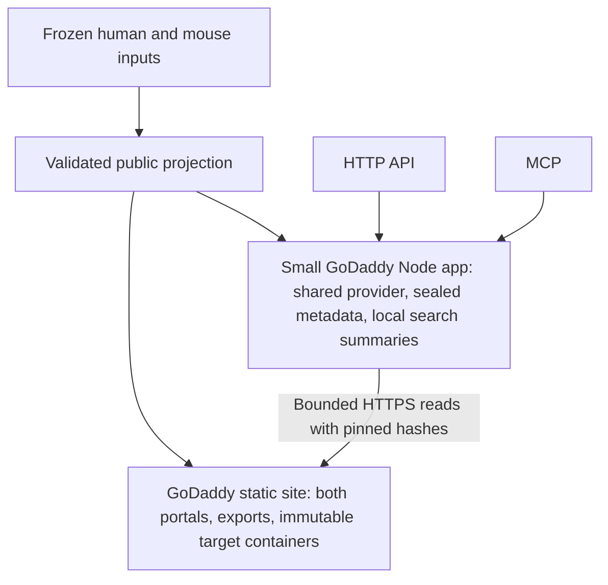

# OpenAntigens API and MCP plan

## 1. Recommended design

Keep the human and mouse websites static. Add one public, read-only Node.js application on `https://api.openantigens.org`, with a versioned HTTP API and an MCP endpoint. Build its data from the same frozen inputs and final records used for the published portals. HTTP and MCP call the same read functions. Scientific analysis stays in the existing Python build pipeline.

GoDaddy is the fixed hosting provider. Package a small Node app with sealed release metadata, compact search indexes and local full-summary lookup files. Store immutable target containers on the existing GoDaddy static site. Fetch only the selected target's authenticated bytes when needed. Scientific analysis stays offline; this design adds no database, scientific-source requests or new provider.

The first release supports target discovery, target and evidence retrieval, released construct selection, exact released sequence export, release metadata, and citation/schema references for both species. Bulk analysis uses the static website's downloads. The service returns released public information. User sequence submission, custom boundary editing, mutations, fresh predictions, BLAST jobs, private IPI data, accounts, and write operations remain outside this release.

## 2. Evidence and constraints

The source baseline is canonical `proteininnovation/OpenAntigens` commit `8008192`. The design uses these existing components:

| Component | Reuse and constraint |
| --- | --- |
| `src/agdesign2/portal.py`, `build_portal` | Final index entries and report values already feed pages and downloads. Add the public projection at this shared boundary. |
| `portal.py`, `_portal_download_rows` and `_portal_download_fields` | Existing compact public field selection. Extend a new versioned API schema; keep existing download columns compatible. |
| `portal.py`, construct export-row assembly and `_export_tsv` / `_export_fasta` | Extract reusable value assembly so portal and machine exports use the same species sequence, mapping decisions, coordinates, and warnings. Preserve existing browser export behavior. |
| `src/agdesign2/mouse_portal.py` | Uses the common builder with mouse provenance, theme, relative links, and `include_disease_context=False`. Preserve these differences. |
| `src/agdesign2/dynamic_portal.py`, `/api/genes` and `/api/gene/{entry_name}` | Development interfaces return broad or raw payloads and can load/refresh assets. They are references for existing callers, not the production service boundary. |
| `src/agdesign2/portal_db.py` | Useful schema, lookup, and hash patterns. Its database contains raw report/entry JSON and differs from the static path. Do not ship it as the public service dataset. |
| `scripts/build_public_release.py`, `src/agdesign2/release_validation.py` | Reuse packaging, public-file checks, species validation, coverage checks, and checksums. Add API projection checks. |
| `scripts/deploy_snapshot_to_godaddy.sh` | Static deployment uses `rsync --delete-before` and protects only `.ftpquota` and `.well-known/`. Keep the managed application and its data outside that mirrored publish root. |

The authenticated GoDaddy dashboard was checked read-only on October 25, 2026 and confirmed that Node.js Apps are included with the current hosting plan. No app was created. App-specific limits, proxy behavior and MCP operation remain launch gates. See [host verification](API_MCP_HOST_VERIFICATION.md); account-specific evidence stays outside the public repository.

The local frozen-catalogue profile contains 9,949 targets and 78,125 constructs across both species. Its generated release manifest is 79,027,981 bytes. Package and runtime measurements are recorded in [implementation review](API_MCP_IMPLEMENTATION_REVIEW.md); local results do not establish the managed host's limits. Existing coverage thresholds are build safeguards and do not establish scientific validity.

## 3. User functions

| User task | Required behavior |
| --- | --- |
| Find a target | Search gene names, aliases, accessions, entry names, protein names, family, and topology within an explicit species and release. Return candidates; keep ambiguity visible. |
| Find suitable records | Narrow a gene/accession query by catalogue track, processing state, structure availability and construct availability. Keep analyzed topology separate from catalogue inclusion rationale. Read human disease evidence for one target at a time. |
| Inspect a target | Return identity, canonical sequence identity, processing state, design intervals, section availability, report link, and provenance. |
| Inspect evidence | Read bounded sections for topology, domains/PTMs, orthologs, paralogs/family, assembly, structures/PDB, sequence similarity, literature links, and human disease associations where released. |
| Select a construct | List the released construct classes, boundaries, sequence identity, source, selection score, evidence, structural metrics, and warnings. Preserve separate PDB records and the portal's construct classes. |
| Export sequence | Return the exact released reference or construct sequence as JSON or FASTA, with accession/source, species, coordinates, length, checksum, and warning/provenance references. |
| Reproduce a result | Use explicit release IDs, schemas, software/source provenance, manifest hashes, citation files, and retained downloads. |
| Analyze many records | Use the static website's downloads. API/MCP functions support individual target lookups and small follow-ups. |

The service describes model scores and predictions with their recorded meaning. Processing success does not establish experimental validation. Sequence similarity does not establish specificity, epitope identity, or cross-reactivity. Empty results do not establish biological absence. These interpretation rules belong in schemas, tool descriptions, and the common agent guide.

## 4. Public data contract

### Identity and versions

- `api_version` is the HTTP contract major version, initially `v1`. `schema_version` identifies the data schema and changes only through a documented migration.
- `release_id` is immutable and binds both species, the scientific snapshot, software commit, projection schema, and canonical public payload hashes. Compute those payload hashes before adding release envelopes/IDs, from canonically serialized public records and retained asset hashes. Hash that manifest core to obtain the ID, then write envelopes and final byte checksums. Keep the manifest's own checksum in a separate sidecar. This two-pass construction avoids a hash cycle. A code-only service deployment has a separate `service_build_id` and preserves the data release ID.
- A resolved `target_id` is `taxon:identifier_source:identifier_accession`, with taxon `9606` or `10090` and identifier source `uniprot` or `refseq`. Preserve isoform suffixes and identifier provenance. Separately store `sequence_accession`, `sequence_source`, and `sequence_sha256`. A mouse fallback can keep a UniProt homolog identifier while using a RefSeq sequence from the ortholog table; its exported sequence must name the actual sequence accession/source. When the sequence accession is unrecorded, use null plus the recorded source and hash, not the target identifier as an invented substitute.
- Gene names and entry names are search aliases. Detail retrieval uses the canonical target ID. Exact aliases can yield several candidates; the service never chooses one silently.
- Source rows without a resolved accession remain visible in release status counts and catalogue downloads, with `target_id=null`, a release-scoped `record_id`, and an explanation. Search may return these rows; they have no invented biological ID or sequence endpoint.
- A `construct_id` is a deterministic SHA-256 of a canonical tuple: target ID, `category`, raw stored `classification`, source-record identity, coordinates/sequence basis, and exact sequence checksum. Its enclosing release provides scope; the ID calculation excludes release ID to avoid a dependency cycle. Preserve distinct PDB provenance. Deduplicate only records whose full identity tuple is identical; retain all evidence links. A construct ID is meaningful within its declared release. Freeze the canonical tuple schema and a fixture digest before implementation so labels and ordering cannot silently change IDs.

### Common response fields

Each successful data response contains `release_id`, `schema_version`, species/taxon where applicable, `data`, and manifest/provenance links. Collections also contain `next_cursor` and `total` computed under the same filter. API response time is distinct from source retrieval, analysis, and release dates. Record unknown historical source versions or dates as `null` with a reason.

Target summaries include IDs, names/aliases, distinct identifier and sequence accessions/sources, sequence hash, processing state, catalogue track, analyzed topology/source, numeric design intervals, construct counts, structure flags, section availability, and the species-specific report URL. The catalogue bucket is an inclusion rationale; it cannot fill a missing analyzed topology or design interval. Omit internal paths, raw input queries, source-column names, timing/debug fields, exceptions, and broad metadata dictionaries even if an old export includes them.

Each section carries `state`: `available`, `no_results`, `unavailable`, `not_applicable`, `error`, or `unknown`. Use `no_results` only when evidence shows a completed query. Where source history cannot distinguish empty from unqueried, use `unknown`. Use safe error categories and a public explanation. Never serialize upstream exceptions.

Human disease evidence follows the website's first 100 recorded associations in published source order. Its machine-readable coverage records the projection limit, projected count, full recorded source count when known, and a clearly labelled live original-source reference with checksum. Mouse disease evidence remains not applicable. The original complete website TSV remains unchanged and outside the app package. This is a bounded projection, not a claim that other associations are absent; disease-ID catalogue filtering is outside the interactive API.

Coordinates are **1-based inclusive** in the explicitly named reference sequence. Keep absent values as `null`, measured zero as zero, and unknown flags as unknown. Store exact sequence text, source accession, length, and SHA-256 during the Python build. Node reads those values; it does not map homologs, infer boundaries, or reconstruct engineered sequences.

Each construct preserves raw stored `classification` separately from API `category`. The category uses the existing Construct Details tab grouping, including its final multipass split: group 0 → `full_region`, 1 → `pdb`, 2 → `domain_repeat`, 3 → `strict`, 4 → `lenient`; group 5 with `name=membrane_expression_full_length` → `multipass_full_length`, other group-5 names → `multipass_trimmed`. Reuse/extract that exact mapping from the Python renderer. The `category` filter accepts those seven tokens. Raw `classification` remains nullable source data, such as `soluble_ecd` or `membrane_expression`, and is not a filter alias. An unexpected grouping blocks schema validation until reviewed.

For ordinary contiguous native constructs, require `1 <= start <= end <= reference_length`, declared length and sequence length agreement, and agreement with the declared reference slice. Handle a recorded PDB or engineered sequence as its own sequence basis when it differs from that slice; require explicit mapping/provenance and preserve substitutions. If a source variant cannot be represented faithfully, mark its export unavailable with a reason rather than supply a native substitute. User-edited browser variants remain local to the browser. Unsupported linker/cassette/replacement variants are advertised as unavailable in v1.

Structure, figure, and bulk-download links are generated from the **final packaged public manifest**. Do not link to a model removed by deployment compression, a private file, an absolute local path, or an asset from another release. A stable report URL may show a later release; label it `live_report_url`. Immutable machine data and archives carry the reproducible evidence.

All text fields use plain text with bounded length. Treat source annotations, names, rationale, publication titles, and URLs as untrusted data. Preserve scientific meaning; if a whole record exceeds a response budget, return an explicit size error and a manifest-listed download rather than silently cut its content.

### Artifacts

Build a private staging directory with `manifest.json`, versioned JSON Schemas, `human/index.json`, `mouse/index.json`, target/section/sequence shards, and prebuilt download metadata. The service bundle contains only validated public projections. Large scientific matrices, raw alignments, PAE arrays, cached HTML, BLAST databases, credentials, raw reports, and local build state stay out.

Build public static downloads for the species indexes and released constructs in JSONL/TSV and FASTA, plus schemas, manifest, and citation files. Also require a complete `records.jsonl.gz` per species: typed records for every projected target, evidence section/page, construct and reference/construct sequence, including identity, source, warnings, and availability. The JSONL is complete for the public projection; it does not include excluded raw scientific matrices/private inputs. Generate deterministic gzip bytes and test a full decompression/parse plus equivalence with every projected shard. This file is the guaranteed overflow fallback for any data result; its final manifest entry and immutable URL are required before the service is ready.

Put downloads at `/data/releases/{release_id}/{species}/...` in the static artifact. Include downloads for every release the app advertises as retained in each new static package, so the existing mirror preserves them by construction. Validate capacity for both copies before launch. Stream downloads during packaging; measure their size. Use existing format helpers where their semantics match. New API export formats have explicit provenance columns/headers; existing browser downloads retain their established columns and behavior. Overflow errors identify the release/species, record/section IDs, full download URL, byte size, media type and checksum; clients can locate the exact complete record without guessing which file contains it.

For each file, record media type, byte length, SHA-256 of downloadable bytes, compression/encoding, species, row count where relevant, schema, and license/source attribution. If compression changes bytes or removes a file, compute the final byte manifest afterward. Separate canonical payload hashes from transport-byte hashes. The manifest core supplies the release ID before envelopes are written; a finalization pass fixes file hashes without changing payload identity. Raw large structure assets stay in their existing public location; label these links as live asset links with recorded source/hash, rather than claim historical assets remain immutable there.

## 5. HTTP API

Serve the following routes under `https://api.openantigens.org`. Data routes require a literal published release ID; only discovery resolves `current`. This keeps pagination and scientific comparisons stable during a new publication.

| Method and route | Contract |
| --- | --- |
| `GET /v1/releases` | List retained releases and identify `current`; include availability/retention policy. |
| `GET /v1/releases/current` | Resolve current release metadata. Return its literal ID and links; `Cache-Control: no-store`. |
| `GET /v1/releases/{release_id}` | Counts, capability map per species, dates, source/software provenance, license, citations, schemas, and final manifest. |
| `GET /v1/releases/{release_id}/{species}/targets` | Require a literal `q` with at least two trimmed characters. Return candidates in stable-ID order within the fixed 20-match window; request a narrower query beyond that window. |
| `GET .../{species}/targets/{target_id}` | Bounded target summary and section counts/availability; sequences and large evidence arrays require explicit routes. |
| `GET .../{species}/targets/{target_id}/sections/{section}` | Allowlisted, paged evidence section; section enum defined below in section 5. |
| `GET .../{species}/targets/{target_id}/constructs` | Paged constructs; optional `category` filter with the seven tokens defined in section 4. |
| `GET .../{species}/targets/{target_id}/sequence?format=json\|fasta` | Exact released reference sequence. |
| `GET .../{species}/targets/{target_id}/constructs/{construct_id}/sequence?format=json\|fasta` | Exact released construct sequence and provenance. |
| `GET /healthz`, `GET /readyz` | Minimal liveness and validated-bundle readiness; no paths, environment values, or credentials. |
| `GET /openapi.json` | Versioned API description with example fixtures, error codes, schemas, limits, and links to interpretation guidance. |

`species` is exactly `human` or `mouse`. Reject a species/target mismatch. The complete `section` enum is `topology`, `domains`, `ptms`, `orthologs`, `paralogs`, `family`, `assembly`, `structures`, `similarity`, `literature`, `disease`. Each has a declared schema and availability state. `disease` requires the human release capability; unsupported sections/filters return the typed capability error, while a supported section can report no results/unavailable/unknown.

Search accepts only `q`, `track`, `status`, `structure`, `constructs`, `limit`, and `cursor`. Construct lists accept only `category`, `limit`, and `cursor`; sections accept only `limit` and `cursor`; sequence routes accept only `format`. Reject unknown keys, duplicate scalar query arguments, and inappropriate keys on all routes. MCP schemas expose the same normalized arguments and exact tokens.

| Filter | Exact contract |
| --- | --- |
| `q` | Required string with at least two trimmed literal characters; case-insensitive substring over projected public search fields, including accessions and aliases. Reject empty queries and wildcards. |
| `track` | `secreted`, `gpi`, `single_pass`, `multipass`, `other`, `unknown`. Derive using a tested shared catalogue-bucket normalization; retain the raw bucket label and keep analyzed topology separate. Missing source → unknown. |
| `status` | `ok`, `error`, `pending`, `running`, `started`, `skipped_existing`, `unknown`; preserve the final portal source state. These describe the frozen build record, not a live running job. An unrecognized source token is preserved in a raw label and maps to unknown until reviewed. |
| `structure` | `available`, `unavailable`, `unknown`, referring to packaged public structure availability, not biological absence. |
| `constructs` | `available`, `unavailable`, `unknown`, based on the released count/availability state; null is not zero. |

Do not implement user regular expressions, SQL, arbitrary field predicates, arbitrary sort, or a new search engine. Define public field names, exact normalization and representative fixtures in the versioned schema/OpenAPI before service code.

Use a cursor containing release ID, species, normalized filter fingerprint, fixed sort version, and validated position. Base64url encoding is an opaque convenience, not authentication. Validate every field and position; tampering cannot increase a page bound, read a path, or pass the twenty-match search window. A cursor for another query/species/release returns `400 invalid_cursor`. Sorting includes a deterministic tie-breaker for unresolved catalogue rows. Require a literal query of at least two trimmed characters. Broad matches require query refinement; complete catalogue enumeration and batch requests are outside this service contract.

Limits are initial **engineering settings to validate on the host**, not capacity claims:

| Limit | Initial setting |
| --- | --- |
| Query | 200 Unicode code points; total request URL 4 KiB |
| Collection | Default 5, maximum 10 records; search exposes at most 20 matches per query |
| Detail/export scope | One target or one construct per request; no arbitrary bulk body |
| Ordinary JSON result | 256 KiB serialized; use section pagination or a static download on overflow |
| Single sequence/export | 1 MiB serialized; larger records use a prebuilt manifest URL |
| HTTP request body | 32 KiB, uncompressed; public GET routes reject bodies |
| Concurrent admitted work | 2 requests per process, 1 per client; no waiting queue, excess returns 429 |
| Admitted handler budget | 5 seconds; measure and test slow reads and client disconnects |

Return stable machine error codes, a request ID, and a safe message. Use `400` for malformed/unknown arguments, `404` for unknown IDs, `410` only for a known retired release with a published tombstone, `413` for request/result size limits, `405` for unsupported methods, `406`/`415` for unsupported media types as applicable, `429` with `Retry-After` for admission limits, and `503` when the required release/bundle is unavailable. Never substitute another release on a lookup failure. For unsupported species-specific sections/filters, return a typed `unsupported_capability` error; successful metadata explains the capability map.

GET/HEAD public data responses support ETags. Literal-release immutable data may use public immutable caching only after an ID and its bytes are fixed. Errors, health/readiness, `current`, MCP POST, and maintenance responses use `no-store`. A `304` has no body. A HEAD returns the same representation headers without a body. No API cookies or sessions are required.

## 6. MCP contract

Expose `/mcp` on the same service. Research on October 24 identified MCP **2026-07-28**, official `@modelcontextprotocol/server` **2.4.0** and `@modelcontextprotocol/node` **2.1.2**, compatible with Node 22. Use `createMcpHandler` with `responseMode: 'json'` and `legacy: 'stateless'`, mounted through `toNodeHandler` on `node:http`. Verify the exact compatible patch versions, security status, and lockfile at implementation time. Use these supported handlers rather than hand-writing JSON-RPC or negotiation.

Use **stateless HTTP**. Current-protocol calls return JSON. The official SDK's legacy stateless compatibility path returns a finite, one-response SSE body; it has no standalone event stream, resumable history, or session store. Preserve the supported SDK transport rather than rewrite its framing. Apply the same response-size and request-deadline bounds to both forms, and verify both through the hosting proxy. Advertise tools only. Each tool uses the same schemas, release/species rules, read functions, limits, and error categories as the HTTP API.

| Tool | Parameters and result |
| --- | --- |
| `get_release` | Optional literal release ID; omission resolves current metadata. Outside maintenance, returns selected release metadata plus current and retained release discovery, matching HTTP. During maintenance, an explicit ID returns only its pinned metadata with a publication-state notice; current/retained discovery is withheld. Includes capability map, provenance, schemas and citations; retired history is a bounded count and literal-ID lookup reference. |
| `search_targets` | Required release/species; query, exact filters, limit, cursor. Returns the same catalogue page as HTTP. |
| `get_target` | Required release/species/target ID; optional explicit section and page arguments. Returns summary or one bounded evidence section. |
| `list_constructs` | Required release/species/target ID; optional `category`, limit, cursor. Returns a small page of construct records for that target. |
| `get_sequence` | Required release/species/target ID; optional construct ID. Returns one structured sequence with its declared basis and provenance. |

Declare exact input/output schemas with unknown fields rejected. Tool annotations describe these calls as read-only, idempotent, non-destructive, and closed-world. Annotations help clients; server validation enforces the boundary. Tool results return structured content plus a short text summary that preserves release, species, source, missingness, and interpretation. Tool/data failures use the SDK's tool-error contract; malformed protocol messages use protocol errors. Never put raw exception text in either.

Compatibility acceptance must test the July 2026 `server/discover` and per-request capability/version negotiation, plus the supported legacy initialization/list/call flow. The current flow has no initialize handshake or session ID. Legacy support uses only the SDK's stateless compatibility mode and its bounded one-response SSE representation. Validate `MCP-Protocol-Version`, `Mcp-Method`, and `Mcp-Name` against the message metadata through the SDK, including specified mismatch/version errors. The transport also enforces content negotiation, JSON-RPC validation, notification handling, and unsupported-method behavior. GET/DELETE return the documented 405 response; legacy responses do not require a long-lived GET stream. Explicitly test unsupported versions, malformed/batched and oversized messages, prohibited methods, and current/legacy error differences. Configure Host/Origin guards outside the MCP handler; the handler does not provide that protection by itself. Browser preflight must allow the exact protocol headers in use.

Public read-only data requires no authentication. Private data or administrative methods would require a separate authenticated design and review; do not add a shared API key to this public service. No web admin or deployment tool is exposed through MCP.

## 7. Implementation structure

Keep the existing Python scientific package and add a small isolated JavaScript ESM service, tentatively `services/public-api/`. Node's HTTP, file, URL, crypto, and test modules cover routine needs. Add only the official MCP server/Node adapter and their required schema peer dependencies. Use the supported adapter rather than another web framework unless a measured requirement demands one.

| Area | Planned change |
| --- | --- |
| `src/agdesign2/public_api_data.py` | Typed public projection, shared construct-export values/category mapping, deterministic identity/manifest generation, bounded shard generation, schema validation. Move only the value assembly needed from the portal; keep HTML in its renderer. |
| `src/agdesign2/portal.py`, `mouse_portal.py` | Capture the same finalized values for pages and machine data. One species-aware implementation; explicit mouse capability flags and links. Preserve public UI and existing export compatibility. |
| `src/agdesign2/public_api_release.py`, `public_api_transport.py`, `scripts/build_public_release.py` | Validate both species, stage immutable target assets and static exports, then package the small app with independently pinned query metadata and local summaries. Preserve scientific release IDs and exact data bytes. |
| `src/agdesign2/cli.py` | A reusable local CLI to build/validate the API projection from an explicit frozen snapshot; no implicit upstream refresh. Exact command flags documented with implementation. |
| `services/public-api/` | Config/start entry, sealed metadata, bounded local-summary and static-target readers, HTTP routes, MCP registration, shared schemas, dependency lock and test fixtures. Keep code build, scientific release and physical transport identities separate. |
| `scripts/` | Build/verify the service ZIP; extend deployment orchestration with checks and dry-run boundaries. Credentials and account IDs remain host-local. |
| `tests/` and service tests | Projection/contract/parity/security/regression/integration tests described below. |
| Shared site docs and README | API/MCP connection instructions, species/release examples, limits, citation, privacy and retention. Generate identical common guidance for both portals through `site_docs.py`. |

The app code's `service-build.json` selects the explicit internal format `openantigens-own-static-query-v1` and pins the original source-root hash, query-root hash and exact static origin `https://openantigens.org`. The query-root pins compact per-release metadata, the unchanged target-routing inventory, public schemas, compact indexes, exact full-summary JSONL files and their offset tables. It lists at most two retained releases and the bounded retirement history. A single closed internal schema is shared by the Python packager and Node reader. It is app code, not a schema supplied by an incoming client or remote asset.

Startup validates these local pins, schemas, identities, counts and file inventory. It stream-hashes the summary JSONL files without retaining all summary objects. Each offset table contains `[offset, length, sha256]` tuples aligned with its compact index; coverage, nonoverlap and file bounds are checked. Search reads only the selected five to ten local records with bounded, no-follow seeks, per-record hashes, strict JSON/schema validation and index identity checks. Metadata and search make zero target-asset requests at startup or per search.

The physical transport retains the existing deterministic gzip container bytes, logical paths and scientific release IDs. Staging validates the complete source graph, public fields, scientific fingerprints, all approved exports and final static copies before sealing the query catalog. The app omits the 79 MB full file map and target bodies. A whole-container SHA in the independently pinned local catalog authenticates its exact member bytes transitively; runtime does not need the full leaf-hash map. Unpacked and local-packed formats remain separate supported verification paths.

Static URLs are derived only from validated catalog fields: `/api-runtime/<release_id>/<species>/<target_key>-<part>-<compressed_sha256>.oap`. Including the compressed hash preserves old code builds when the same scientific release is repacked. Files contain the unchanged gzip bytes and use `application/octet-stream` with no HTTP content encoding. The static compressor must leave `.oap` files untouched. Runtime uses the fixed HTTPS origin, identity encoding, no redirects, no cookies, no client headers and a fixed service user agent. It verifies response status/type/encoding, exact compressed size and hash before bounded decompression, strict JSON, role/species/release ownership and schema checks. Target summaries must agree with the local full-summary record. Referenced members must belong to the requested target and the sealed part ranges.

Runtime target work, including warm-cache decoding, has two global permits. Origin fetches also have two slots, no queue and no automatic retry. Each operation has one target context, at most two origin fetches and one absolute three-second asset deadline within the existing five-second handler budget. Each target has at most two parts, four MiB compressed and 32 MiB decoded in total; each part remains limited to 16 MiB decoded. A future target exceeding these build limits blocks the release instead of being omitted or clipped. Shared caching holds only validated compressed bytes, with an eight-MiB/128-entry LRU; request-local decoded data holds at most two parts. Local summary records are bounded to one MiB. Existing API/MCP result, rate, concurrency and privacy limits remain unchanged.

A remote timeout, missing asset, WAF response, corrupt body or schema failure returns a safe request-scoped 503. Bad bytes never enter cache; a later bounded request can recover after repair. These failures do not permanently disable unrelated releases or metadata/search. Invalid local seals or query metadata prevent startup readiness. `/readyz` proves local metadata validity, not that every remote target has been fetched; remote availability is also checked during publication and each data read.

Complete website JSONL/TSV/FASTA and full-record exports remain static downloads. The app keeps exact summary JSONL bytes solely for bounded search lookup and approved metadata for the other exports. Full source/byte parity is a staging responsibility; origin publication verification and runtime hashes protect the static-query boundary. No bulk download route or tool is added.

Start with a 32 MiB compact-index budget, an 8 MiB target storage-shard limit, and 1 MiB evidence/sequence storage shards. These limits bound validation and parsing; they are separate from the smaller response budgets. Split evidence at build time into independently paged shards so a legal page never requires parsing an unbounded array. Validate public text-field maxima in the schema; an oversized source record blocks packaging or gets an explicit unavailable export state agreed in the contract, never silent clipping. Measure peak startup/request RSS against the host's actual limit with headroom.

The application bundle is immutable at runtime. It writes no scientific files and makes no scientific-source requests. Its only data-network reads are bounded requests for its own sealed static assets. Logs use the existing sanitized host channel. Restarts and replicas load the same catalog; no persistent writable filesystem is assumed. A service code change is tested against retained data-schema versions before publication.

A code-only patch may reuse data from a previously reviewed successful full build. This is a separate repack operation requiring the review record and an independently supplied ZIP SHA from that full-build receipt. Verify the archive and every member, extract only data and its old seal into private staging, apply current query/privacy validation, and verify every required static asset, export, source manifest and sidecar. Preserve data bytes, inventory, seals, release IDs and origin exactly; replace all code, dependencies and licenses from the current explicit allowlist and derive a new code build ID. The same size, exclusive-output and dry-run gates apply. Record scientific validation as inherited, not rerun. New projection, scientific schema, transport or data changes require the normal pipeline. A newly found data-boundary defect also requires normal or complete affected-data validation unless the repack checks fully cover it; this is not a general validation-skip flag.

Frozen compilation covers caches/reference tables as well as report JSON. Existing homolog loaders can fall back to working-directory caches. Add an explicit snapshot-scoped resolver for release builds, or materialize all selected mapping/export rows within the frozen snapshot before either renderer runs. The production build mode must reject ambient cwd/global caches, unexpected network access, and an undeclared fallback sequence. Manifest the selected sequence/reference/mapping hashes and use them for both portals and the projection. Missing declared inputs block packaging unless the source contract already represents that exact missingness; never fetch replacement evidence during packaging. Test identical outputs with different poisoned cwd caches and network disabled.

## 8. Cybersecurity design

### Trust boundaries

1. Public Internet and untrusted MCP/browser clients to the managed edge and app.
2. Forwarded headers from the hosting proxy to the app.
3. Upstream public annotations and frozen build inputs to the public projector.
4. Build/deployment credentials and local private scientific material to the distributable artifact.
5. Application code/dependencies and packaged data to the runtime.
6. Tool output to an agent that may follow external text or links.
7. The app's independently pinned local catalog to public static assets and their CDN/WAF path.

| Threat | Required controls and verification |
| --- | --- |
| Private/raw data disclosure | Explicit recursive field schemas with `additionalProperties=false`; no raw reports/DB/cache directories in ZIP or download roots. Scan the completed artifact for local paths, secrets, canary private fields, debug traces, and excluded file types. Test fixtures containing nested secret canaries must fail projection/package validation. |
| Traversal and arbitrary file reads | Manifest ID lookup only; strict decoded identifiers; reject separators, encoded traversal, double decoding, NUL, malformed Unicode, symlinks, and out-of-root paths. Reject unknown query keys. Keep runtime files outside static mirror roots. |
| Static-query forgery, SSRF and resource exhaustion | Derive only hash-qualified paths on the fixed HTTPS origin; no redirects, credentials or forwarded client headers. Verify hashes before bounded decode, strict JSON/schema and target ownership. Cap total parts, bytes, active target work, fetches, deadline and cache. Test corrupt/oversized/encoded/redirected responses, aborts, cache pressure and recovery without global readiness poisoning. |
| SSRF and arbitrary upstream access | No client-supplied or arbitrary URL fetch, upload or proxy. The data reader fetches only sealed own-static assets under section 7; optional analytics uses its separate fixed collector under section 9. External scientific-source links follow the approved domain/scheme policy and are returned as data, never fetched by the service. |
| Injection and source-text execution | Typed filters and fixed substring matching; no SQL, regex evaluation, shell execution, template evaluation, HTML rendering, or dynamic imports from request values. JSON-escape strings and serve FASTA/TSV as text attachments with safe filenames and `nosniff`. TSV display cells need formula-neutralization under the documented export policy while exact machine values stay available in JSON. |
| DNS rebinding and cross-origin access | Validate canonical Host/authority and any present Origin against a configured exact allowlist. Reject `null`/untrusted origins; accept absent Origin for non-browser clients. CORS permits only named production/local test origins, exact methods/headers, and no credentials. Both species portals share the production website origin. No wildcard credential policy. |
| Proxy/header spoofing | Trust client-IP/forwarded headers only when the hosting proxy contract and ingress make them reliable. Verify HTTP-to-HTTPS and host mapping. Ignore attacker-controlled forwarding chains. If trusted client identity is unavailable, use safe global admission control and require an effective edge abuse-control gate before public launch. |
| Cost/resource exhaustion | Edge protection plus app body, URL, result, concurrency, file-read and time limits. Use 20 requests/minute/client with burst 8, and 90/minute/process with burst 10; HTTP and MCP share quotas. Limit work to two admitted requests per process and one per client. Cross-process enforcement requires a verified edge control; per-process counters alone are insufficient under scale-out. Require explicit small queries, bounded windows, and single-record exports. |
| HTTP/protocol abuse | Strict method/media/header validation; body cap before JSON parsing; reject compressed request bodies, unsupported batching, duplicate/ambiguous security headers, and slow/incomplete bodies. Set header/body/idle timeouts through supported Node/host controls. Abort reads/work after disconnect/deadline. Return bounded safe errors. |
| MCP prompt injection | Descriptions identify source text as data. Return structured records and source URLs; do not repeat source prose as instructions or add executable commands. The service exposes no writing, upload, user-directed external-fetch or administrative capability. Test malicious annotation fixtures. This limits service impact; it cannot guarantee how every downstream agent uses public text. |
| Dependency/build compromise | Pin supported Node major and exact package versions; commit lockfile; deterministic `npm ci`; review install scripts, dependency changes, licenses, audit results, and provenance. Prefer official MCP modules and standard library. Build from canonical repository and reviewed PRs. Runtime carries no repository write token or scientific-source credentials. |
| Artifact tampering or release mixing | Validate local catalog/schema/hash authority before readiness, and remote hashes/schema/ownership before use. Verify transfers and application packages, TLS, source release identity and explicit IDs. An embedded checksum detects corruption, not a malicious publisher; protect deployment authority and retain reviewed artifact hashes separately. |
| Compromised app affecting the static website | Verify managed-app OS/container identity, filesystem and credential isolation from cPanel/static content and other account applications. Application-level read-only behavior is insufficient if the same OS user can modify those files. Use GoDaddy-supported isolation controls. If isolation remains insufficient, public launch stays blocked until the owner explicitly accepts the documented cross-site risk. No provider change is authorized. |
| Misconfiguration and error leakage | Validate startup configuration; no debug routes/stack traces/environment dumps; no arbitrary file-serving route. Detailed logs stay private and safe. Public health endpoints expose only state/build identifiers needed for operations. |
| Public asset or cache poisoning | Exact host/path/format/query handling; ignore unrecognized forwarded host values; no user-controlled redirects/download filenames. Cache immutable GETs only; no-store current, POST/MCP, errors and maintenance. Verify effective headers through GoDaddy's edge and any Sucuri route actually in front of the API. |

Use the host's HTTPS termination and certificate renewal only after domain/TLS verification. Set HSTS after confirming the subdomain's HTTPS behavior; do not enable `includeSubDomains` or preload as part of this service. Set `X-Content-Type-Options: nosniff`, restrictive framing/resource headers as applicable, and a default-deny CSP on any HTML documentation shell. Machine endpoints do not render source HTML.

Deployment uses the existing authorized account and least-privilege credentials the host supports. Store secrets outside the repo and app data; never create new long-lived credentials merely for convenience. Extract uploaded archives only through the supported platform path; local packaging rejects archive traversal, symlinks, and unintended files. A public launch, domain/access change, app creation, paid change, push, merge, or deployment requires the user's explicit authorization for that step.

## 9. Privacy, attribution, and operations

The API is public and requires no account, cookie, or sequence submission. Search text and requested targets can reveal research interests. Sanitized application records cover completed, refused and aborted requests: timestamp, random request ID, controlled operation/transport/species, status, error category, timing and response bytes. They omit full URL/query/body, sequences, raw target IDs, names, MCP arguments/results, credentials, raw addresses and user-agent strings. A configured privacy key and verified client identity support daily pseudonymous HMAC client IDs; these describe approximate clients rather than individual people. Bounded backpressure aggregation preserves request totals while explicitly recording unavailable detail.

Use the existing Plausible property for eligible visitor and country/city views, plus complete local JSON/CSV/interactive HTML reports from the sanitized records. Plausible can filter automated or hosting-provider traffic, so its acceptance, provider-drop, failure and local-budget outcomes remain separate from request counts. Optional custom goals are `API Request` and `MCP Request`, with fixed synthetic endpoint-category paths and no custom properties. They receive genuine verified client identity transiently; identities are never spoofed to bypass bot filters. Delivery stays off until goals, quota, client/proxy identity, privacy and deployment prerequisites pass. A fixed 100-attempt process/day collector budget protects optional delivery; restarts and replicas require an operator-level quota check. Complete request recording remains active when collector delivery is disabled, skipped or filtered.

The hosting edge may log client IPs and full URLs independently. Before launch, identify that logging, retention, access and deletion policy and keep the shared privacy page accurate. GoDaddy's documented runtime-log query horizon is seven days; operator exports must occur before records expire. Preserve private source exports and reviewed reports under an explicit retention policy. Reports state their imported time window, missing detail and coverage; they cannot recover upstream requests or logs the host never captured. Reuse the site's aggregate-sharing rules and keep incident records restricted. Never send sequence/search content into analytics. The exact report and operator workflow is in `API_MCP_ANALYTICS.md`.

Measure request/error/429 counts, latency, readiness, process restarts, memory, package/disk use, and release mismatch. Use host monitoring and existing operational tooling where available. Assign a named service owner and backup before launch. Record the check schedule, patch policy, incident contact, and available alert route; notifications or new paid monitoring need authorization.

**Incident response:** disable API/MCP publication/routing through the host control first when abuse or compromise threatens the shared account; keep static portals available where safe. Record bounded private logs and release/build hashes. For accidental public-data exposure, remove the affected artifact, purge every affected edge/download cache, assess retained copies, and notify the owner; public downloads cannot be recalled. Rotate any exposed credential through the authorized account process. A compromised app requires isolation and a trusted rebuild, not a rollback of data alone. A corrupt scientific projection requires quarantining that release ID and coordinated repair/rollback. Re-enable only after the cause is reproduced, fixed, independently checked, and the owner approves the concrete recovery.

Keep the current and previous validated release in the app bundle **only if size and runtime gates pass**. Publish exactly which IDs are retained. Preserve up to 1,000 recent retired-ID tombstones across builds, each with its ID, the release that retired it, and a nullable verified archive URL. These known retired IDs return 410 with that metadata and no substitution. Unknown IDs, including history beyond the published tombstone horizon, return 404. Keep full previous app/static rollback artifacts and hashes locally on controlled storage. An independently published archive is linked only when its durable URL exists. No indefinite online historical-data guarantee is made in v1.

Every response and download exposes OpenAntigens citation and data-license references. Preserve third-party source attribution and release-specific rights. Existing software/data licenses do not establish the rights of every upstream field; review the projected field/source inventory before publication.

## 10. GoDaddy feasibility gates

The required deployment is **one managed GoDaddy Node app plus the existing GoDaddy static site**, under the same account. Put API/MCP routes on a dedicated subdomain and keep app code/local metadata outside the static document root. Package only code and bounded local query files in the managed upload; publish target containers separately as immutable static assets. Use managed deployment/restart rather than an SSH-launched background process.

Official GoDaddy documentation inspected on October 24 describes managed **Node 22**, a root `package.json` with build/start scripts, `main` included for compatibility with the help requirements, and a listener using `process.env.PORT`. Use plain JavaScript with a validation-only build script and `npm start`, which runs `node src/server.js`. Upload source/lockfile/data as a ZIP **under 100 MB**; omit `node_modules`, `.env`, caches and the full repository. Use the same app ID for updates. Upload replaces preview source; publish promotes it. Preview and publish have separate source/configuration, and STDOUT/STDERR logs are available. Check source import, publish status and runtime readiness separately. Deployment history does not prove a one-click rollback or persistent disk.

The documented Node 22 runtime and ZIP limit are evidence for the design; verify the live account matches them. Extracted disk, memory, build/connection timeouts, and process/replica limits remain unknown. GoDaddy's logs API documents queries up to seven days back; align the app retention policy with actual host capabilities rather than assume the proposed 14-day window is supported. Do not assume a cPanel Python selector or SSH executable proves hosted Python web-app support.

The previous all-data ZIP measured 245,426,866 bytes and was correctly refused. The implemented GoDaddy split now has an actual current-plus-previous artifact of 12,909,859 bytes ZIP and 82,198,385 bytes expanded, within the unchanged budgets. Its 18 local data files are byte-identical to the successful full-validation baseline; current code-only checks and inherited scientific validation are recorded separately. The two releases have 19,898 authorized static containers totaling 447,159,606 bytes. Local Node 22.23.4 runs passed both publication modes, both species and all five tools through HTTP/MCP; reported app startup was about 0.44 seconds and largest-target peak RSS was 348,897,280 bytes. These local fixture measurements establish artifact/runtime feasibility, not live host behavior. GoDaddy remains fixed; actual proxy, TLS, WAF, headers, limits, terms and rollback checks remain launch gates.

Before app creation or public deployment, verify all of the following:

1. The existing subscription still includes an unused app slot; identify its tier and any app-specific limits or charges. Confirm reuse of a fixed app ID and authorized deployment method.
2. The available Node runtime supports the selected official MCP packages, build/start scripts, standard library APIs, and packaged data-file access.
3. A custom `api.openantigens.org` domain, managed certificate, canonical host, and POST routing are supported. Confirm which CDN/WAF/proxy serves this subdomain; the apex Sucuri configuration does not establish API coverage.
4. Stateless MCP JSON requests and their negotiation headers reach the app intact. Check response headers/media types, OPTIONS if browser access is supported, POST body limit, request timeout, redirect behavior, and no HTML challenge for normal clients.
5. The complete app ZIP/local query files fit the managed upload, extracted disk, inode, build/runtime memory and startup limits with headroom. Separately measure both portals, immutable query assets, all exports, retained/rollback asset unions and other account data against actual static disk/inode/transfer allowances. A ZIP-size pass alone is insufficient.
6. Verify app deployment/rollback behavior: old/new traffic overlap, readiness gating, process count, restart, artifact persistence, logs, old-version retention, and whether a failed deployment preserves the old app. Runtime-writable storage is not required by this design.
7. Confirm effective rate/body/concurrency controls across actual replica count and trusted proxy identity; verify log retention, owner access, preview privacy, and isolation from the static site/account credentials.
8. Reserve capacity for app/data plus static deployment and a tested rollback. Existing static hosting is quota-constrained. Do not remove backups or user material to make room without specific authorization.

Failure of a required gate blocks public launch until corrected within the fixed GoDaddy design. Preserve the full contract and the approved top-100 disease scope. No provider change, new spending, database, public authentication or reduced scientific coverage is authorized. Do not silently omit a species, section or record.

## 11. Coordinated release, deployment, and rollback

The current static rsync deployment is **not atomic**. It can expose mixed files while copying and cannot commit in one transaction with a separate managed app deployment. Do not promise an atomic site/API switch. Use explicit IDs and a controlled publication window:

1. **Build and freeze.** Select the intended canonical commit and frozen scientific snapshot. Build both portals and the public projection without re-running source analysis during service packaging. Preserve source inputs and existing release safeguards.
2. **Package and verify.** Finish static compression/removal, finalize the scientific release, then build and seal the small app/local query files and immutable static assets. Validate all source content, exports, schemas, species parity, paths, hashes, limits, licenses and actual app/static sizes. Preserve the union referenced by current and rollback app catalogs, including different transports of the same scientific release.
3. **Authorize the concrete release.** Present the checked artifacts, exact domain/app target, measured capacity, dependency/security results, rollback path, any account changes, and costs. Only then request approval to publish. Reverify `origin=proteininnovation/OpenAntigens`; code for main goes through its PR workflow.
4. **Test the managed app privately.** If the host offers restricted staging, use it. Otherwise test locally with the same runtime and reserve the production first-deployment check for the approved window; do not publish an unreviewed preview containing data or assume a public preview is private.
5. **Enter the publication window.** Activate an app-level publication state that makes `current` discovery return `503 publication_in_progress` with `Retry-After` and no-store while old literal-release reads continue. Use an existing trusted deploy control or deploy a small prepared immutable service configuration; expose no HTTP/admin mutation route. Verify this state before changing static files. If the host cannot set it independently, use a prepared maintenance app artifact and include its extra deployment/capacity in rehearsal.
6. **Publish static human and mouse artifacts together.** Upload the new immutable query assets before activating their app catalog. Transfer only assets authorized by the reviewed catalog, not arbitrary files found under the asset prefix. The static deployer must receiver-protect `/api-runtime/***` and `/data/releases/***` from mirror deletion, while retaining normal behavior elsewhere. Never overwrite a hash-qualified path with different bytes. Verify the transferred inventory/checksums and bounded public representative reads, MIME, absent content encoding, TLS/WAF and cache behavior for both species. Purge the actual static cache as required. Keep both portal IDs aligned; schedule the existing in-place page-copy window. No automatic garbage collection is added: deleting retained assets requires explicit authorization after old traffic drains and rollback references are reviewed.
7. **Activate the service release.** Deploy the verified package with the new literal-release data and `current` marker; retain the previous literal-release data. Check readiness and routing. Verify HTTP and real MCP clients through the final domain/edge. A code-only rollout follows the same gate with unchanged data ID.
8. **Verify convergence of deployed components.** Require the live human and mouse metadata and current API/MCP discovery to name the same release, with manifest hashes/counts and representative records/exports matching. Test normal URLs, cache hits, misses, invalid requests, limits, restart, and both species. Record evidence without credentials or search/sequence telemetry. Reopen discovery only when all checks pass; if the prepared package opens it on startup, deployment must stay under an external maintenance gate until these checks complete.

**Rollback:** a service-only fault can roll back code while keeping identical data IDs when compatible. A data or portal mismatch requires a coordinated static/API rollback. Close `current` discovery first, restore the previously verified static artifact and purge/verify both species, then restore the matching app/current marker and recheck both interfaces. Literal-release reads serve only manifest-validated data; corrupted data returns 503. Do not redirect a request for a bad/new ID to old data. Failed deployment or rollback leaves discovery in maintenance and records the required owner action. Rehearse this before launch, including a failed static transfer and failed app start.

Retain enough capacity and artifacts for these operations. If the host cannot keep discovery closed through activation/verification, use an explicitly scheduled full API maintenance window with an edge rule or maintenance app that does so. Public deployment is blocked until that control and recovery path are demonstrated.

## 12. Validation and acceptance

Use small synthetic and approved public fixtures. Cover both species and each contract state; avoid tests that depend on live upstream science services. Existing unit/security/release checks remain required for touched paths. A document review alone does not establish hosting feasibility or scientific validity.

| Area | Required checks |
| --- | --- |
| Identity and schema | Taxon/source/isoform identity; duplicate detection; unresolved rows; deterministic IDs; null/zero/unknown; schema migrations; missing/changed manifest and unsupported schema fail readiness. |
| Scientific projection | Page/index/API values from the same finalized record; required assembly vs optional assembly; AlphaFold sequence match; homolog mapping/withheld state; reference/native/PDB sequence basis; coordinate/length/checksum agreement; no inference of specificity or experimental success. |
| Species parity | Same endpoints/tools, filters, error contracts, documentation and pagination; mouse disease section correctly unsupported; mouse/human links and IDs correct; no projected human sequence/claim substituted into mouse data. |
| API/MCP parity | Identical normalized inputs yield the same IDs, values, missingness, order, and bounds; HTTP errors map to defined tool/protocol errors; discovery includes citation and schema references; overflow errors identify the complete static export. |
| Search and pagination | Portal substring behavior; aliases and ambiguous genes; exact accession; deterministic pages without skips/duplicates; invalid, altered, wrong-filter/species/release cursors; unknown filters rejected. |
| Exports | Exact sequence/checksum and coordinate basis; warning/provenance retained; plain-text headers; line ending/wrap policy; TSV formula-safe display; JSON preserves exact values; largest record and oversize error/download path. |
| Public boundary | Nested private-field canaries, local paths, raw reports/SQLite/caches/secrets, symlinks and external assets rejected; archive contents and final checksums inspected; poisoned ambient caches cannot affect a frozen build. |
| Host/HTTP security | Direct and forwarded Host/Origin spoofing, preflight/CORS, no Origin CLI, invalid headers/methods/media, slow body, body/URL/result bounds, traversal encodings, malformed Unicode, disconnect/cancellation, global/per-client quotas, no source-text execution or SSRF. |
| Static-query transport | Zero target fetches at boot/search; full-summary response parity; exact local slice hashes; fixed-origin/no-redirect/identity-only reads; hash/schema/ownership checks; finite fetch/decode/cache budgets; cold/warm behavior; aborts; remote failure/repair without sticky global outage; old/new asset retention, including same-release repacks. |
| MCP compatibility | Official SDK client plus at least one intended agent client; current negotiation and supported stable legacy flow; tool list/call, invalid/version/batch/notification behavior; JSON-only stateless operation without SSE/session requirements. |
| Resource/deployment | Selected full release package and startup profile; peak RSS below verified budget with headroom; cold start/restart, two admitted concurrent queries across distinct clients and bounded refusal above the configured limits, p95 within an agreed measured budget; disk/inodes/log growth; replica quota behavior; no live load test without authorization. |
| Release/rollback | Final compressed bytes and asset availability; same ID both portals and service; old pinned calls during publication; stale edge/current cache; failed upload/start/hash; two simultaneous releases; rehearsal of coordinated rollback and maintenance failure. |

Acceptance requires all contract/security tests, selected existing Python tests, actual human and mouse build-path checks, and service tests on the host's supported Node major. Smoke-test the final domain through its real proxy/WAF. Include a second client implementation to detect a test that merely mirrors the server SDK. Do not mark a deployment complete from local success or a GoDaddy upload acknowledgement.

## 13. Implementation sequence and launch decision

1. **Feasibility and contract:** confirm hosting gates and client/protocol support; measure one frozen release; lock schemas, route/tool contracts, field/source inventory, limits, and retention. Deliver a tiny synthetic-data host probe only with authorization to create/deploy it.
2. **Public projector:** share the required export values, emit both species and provenance, add build CLI/schema checks and meaningful fixtures. Keep all scientific computations in Python.
3. **Read service and HTTP:** implement one manifest-backed data provider, typed search/section/export operations, bounds, errors, health, caching, and OpenAPI; validate full-release memory and package budget.
4. **MCP adapter:** register the five tools against that provider with the chosen official SDK, schemas/annotations, stateless transport, compatibility and security checks.
5. **GoDaddy packaging and operations:** build the small managed app with sealed query metadata and local summary lookups; stage exact static target containers, preserve current/rollback assets and add protected dry-run/release/rollback checks. Confirm existing rate, privacy and log controls for both species.
6. **Independent adversarial review and rehearsal:** review the implementation and deployment artifact, fix findings, rerun targeted checks, and rehearse failed publication and recovery. Planning review does not replace this implementation review.
7. **Reviewable publication:** supply the evidence and exact authorized actions from section 11. Publish only after approval; verify ordinary live HTTP/MCP and both portals.

The implementer owns code and test evidence; the site owner approves data/release/cost/access decisions; an independent reviewer checks the public boundary and deployment controls. Assign the operational owner and backup before launch. Hosting/session access, owner assignment, and host measurements are required operational inputs rather than reasons to leave the architecture unspecified.

## 14. Source pointers

Repository references use baseline `8008192` and must be rechecked if implementation starts from a later revision:

- `src/agdesign2/portal.py:90–220` shared build; `3242–3441` downloads/metadata; `4761–4858` construct export row assembly; `8585–8606` structure/assembly flags; `9170–9197` serializers; `9540` and `9629` homolog mapping helpers.
- `src/agdesign2/mouse_portal.py:202–255`, `736–743`; `src/agdesign2/deployment.py:362–393`, `810–847`, `961–1047`.
- `src/agdesign2/dynamic_portal.py:91–172`, `336–346`, `386–392`, `496–529`; `src/agdesign2/portal_db.py:137–140`, `272–310`, `422–429`, `492–530`.
- `src/agdesign2/data/agent_guide.md:20–56`; `src/agdesign2/release_validation.py`; `scripts/build_public_release.py`; `scripts/deploy_snapshot_to_godaddy.sh:408–427`; `tests/test_portal_security.py`, `tests/test_godaddy_deploy.py`, `tests/test_portal_db.py`.
- Hosting account evidence: original checkout `outputs/deployment-2026-10-17/hosting-capacity.png`, `PLAN.md`, and `deployment-status.json`. These establish dated account/deployment context; they do not establish live MCP compatibility.
- [GoDaddy Node app requirements](https://developer.godaddy.com/en/docs/api-users/hosting/app-requirements), [Hosting API overview](https://developer.godaddy.com/en/docs/api-users/hosting), [Node app ZIP upload guidance](https://www.godaddy.com/help/upload-my-ai-generated-app-to-godaddy-nodejs-hosting-42987), [Node 22 deployment guide](https://www.godaddy.com/resources/news/deploy-a-node-js-app-to-godaddy-from-your-terminal-or-let-your-coding-agent-do-it), [preview/publish concepts](https://developer.godaddy.com/en/docs/api-users/hosting/concepts), [domain attachment](https://developer.godaddy.com/en/docs/api-users/hosting/attach-domain), and [logs API](https://developer.godaddy.com/en/docs/api-users/hosting/read-logs).
- [MCP 2026-07-28 specification](https://modelcontextprotocol.io/specification/2026-07-28), [HTTP binding](https://modelcontextprotocol.io/specification/2026-07-28/basic/transports/streamable-http), [official SDK HTTP serving](https://ts.sdk.modelcontextprotocol.io/v2/serving/http.html), [legacy stateless compatibility](https://ts.sdk.modelcontextprotocol.io/v2/serving/legacy-clients), [authorization](https://modelcontextprotocol.io/specification/2026-07-28/basic/authorization), and [MCP security guidance](https://modelcontextprotocol.io/docs/2025-11-25/tutorials/security/security_best_practices).
- Registry versions inspected on October 24: [server 2.4.0](https://registry.npmjs.org/@modelcontextprotocol%2Fserver/2.4.0), [Node adapter 2.1.2](https://registry.npmjs.org/@modelcontextprotocol%2Fnode/2.1.2).

Planning review findings, decisions, and convergence criteria are recorded separately in `API_MCP_REVIEW.md`.
